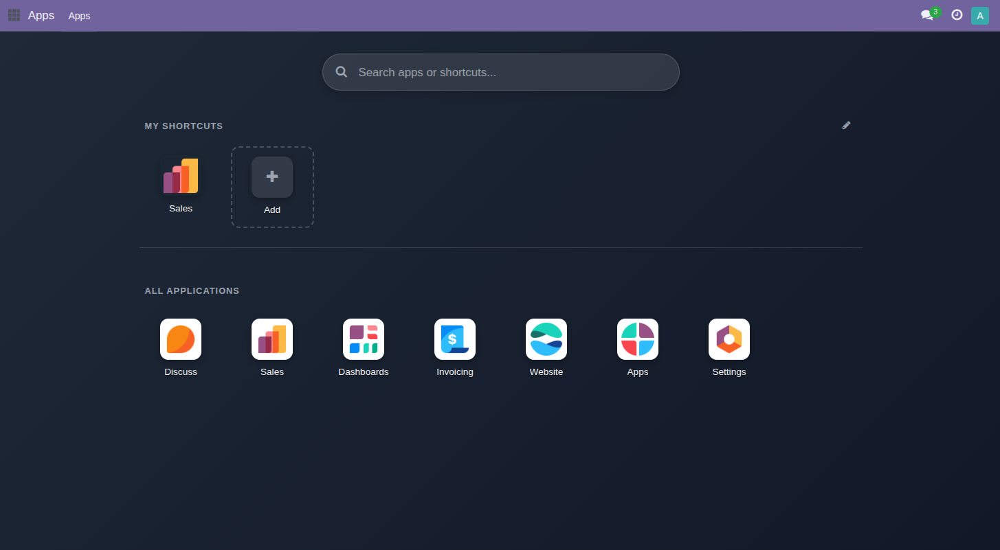

# Personal Apps Shortcuts for Odoo 17 CE

**A standalone, responsive Fullscreen Apps Launcher for Odoo 17 Community Edition (CE) featuring private per-user shortcuts, HTML5 drag-and-drop reordering, and a 1-click installed app picker.**

`personal_apps_shortcuts` replaces the default narrow navbar dropdown with a modern fullscreen application launcher. Users can pin their favorite installed apps, reports, or custom links right at the top of the launcher with smooth drag-and-drop reordering and real-time reactive updates.

---

## 📸 Interface Preview

---

## 🌟 Key Features

- **🚀 Standalone Fullscreen Launcher:** Replaces the standard dropdown with an expansive, responsive application menu. **Zero dependencies on `web_responsive`** or other external addons (depends solely on `web`).
- **🎯 1-Click App Picker (`+` Tile):** Click the `+ Add` tile to open a clean modal listing all installed Odoo apps. Click any app to instantly add it to your personal shortcuts with its original icon and internal action link — no typing or configuration needed.
- **🔄 Drag & Drop Reordering:** Smooth, native HTML5 drag-and-drop support. Rearrange your shortcuts on desktop and see sequence changes persist immediately to the database.
- **⚡ Real-Time Reactive UI:** Powered by Owl 2 reactive states (`useState`). Adding, updating, reordering, and deleting shortcuts update the UI instantly without needing a page refresh.
- **🔍 Integrated Live Search:** Search through all installed applications with instant keyboard navigation (press <kbd>H</kbd> to open/toggle, search apps, and press <kbd>Esc</kbd> to close).
- **🔒 Private & Secure by Design:** Enforced by strict Odoo record rules (`[('user_id', '=', user.id)]`). Shortcuts created by one user are never visible or accessible to any other user or administrator. Dangerous URL schemes (`javascript:`, `data:`, `file:`) are strictly blocked.
- **🖼 Custom & Module Icons:** Automatically fetches and formats app icons (PNG, SVG base64). Fallback color-coded initial tiles are generated if no image is available.

---

## 📋 Compatibility

| Parameter | Details |
|---|---|
| **Odoo Edition** | Odoo 17.0 Community Edition (CE) |
| **Dependencies** | `web` (Completely standalone, no external packages) |
| **Hosting** | On-Premise, Odoo.sh, Docker, Cloud |
| **Languages** | English, Bahasa Indonesia (`id.po` included) |

---

## 🚀 Installation & Setup

1. Copy the `personal_apps_shortcuts` folder into your Odoo custom addons directory.
2. Update the apps list via **Apps → Update Apps List** (with Developer Mode activated).
3. Search for **Personal Apps Shortcuts** (`personal_apps_shortcuts`) and click **Activate / Install**.
4. Click the app menu launcher button in the top navbar (or press <kbd>H</kbd>) to start organizing your shortcuts!

---

## 🛠 How to Use

1. **Open the Launcher:** Click the grid launcher button in the top navbar or press <kbd>H</kbd>.
2. **Add an Installed App (1-Click):**
   - Click the **`+ Add`** tile in the *My Shortcuts* section.
   - Use the search bar or scroll to find any installed application.
   - Click the app card to instantly add it as a shortcut.
3. **Add a Custom URL (Optional):**
   - Click the *"Add custom URL manually"* link at the bottom of the picker modal.
   - Specify name, external or internal link, and optional icon image.
4. **Reorder Shortcuts:**
   - Click and drag any shortcut tile to drop it into your preferred position.
5. **Edit or Delete:**
   - Click the pencil icon to toggle edit mode.
   - Click the trash icon to remove a shortcut in real time.

---

## 🤝 Support & Author

- **Author:** Arif N Ramadhan
- **Company:** NIITS Inovasi Teknologi ([www.niits.id](https://www.niits.id))
- **Email:** [sqlrif@gmail.com](mailto:sqlrif@gmail.com)

---

## 📄 License

Published under the **Odoo Proprietary License v1.0 (OPL-1)**.  
Copyright © 2024–present Arif N Ramadhan. All Rights Reserved.
